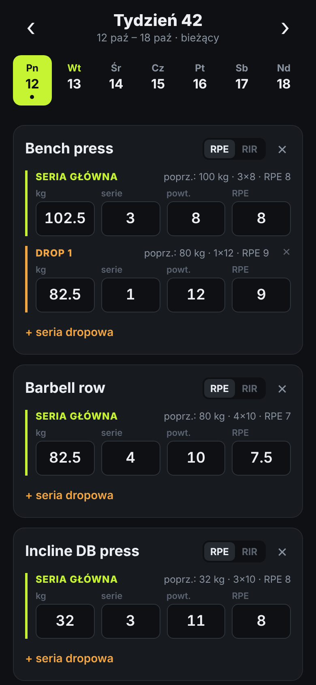
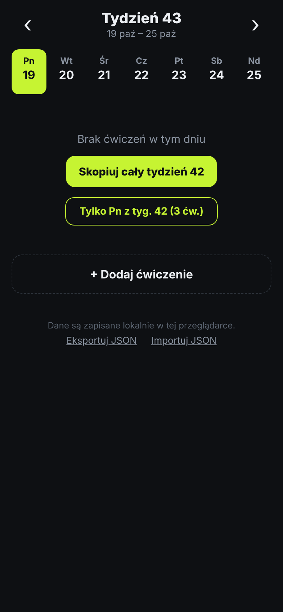

# tmarlog

**My personal strength-training log — a mobile-first, offline-capable PWA built with Expo / React Native.**

> 🚧 **Proof of concept, under active development.** Core logging works and I use it at the gym; expect rough edges and frequent changes.

**▶ Live demo: [tmarlog.codeby.pro](https://tmarlog.codeby.pro)**. Open it on your phone and add it to the home screen to use it like a native app. Data stays in your browser, so feel free to experiment. The UI is currently in Polish (English localisation is on the roadmap).

<p>
  
  &nbsp;&nbsp;
  
</p>

## Why

Gym-tracking apps tend to be either bloated or built around rigid programmes. I wanted something that matches how I actually train: the same weekly split, progressing load, reps and effort (RPE/RIR) week over week, with drop sets after the main working sets. And it had to work in a basement gym with no signal.

The name is a nod to my coach: **t**rener **Mar**ian **log**.

## What it does

- **Weekly structure:** navigate by ISO week and switch between Monday and Sunday. Days with entries are marked.
- **Exercises:** each exercise has a **main set block** (weight, sets, reps, RPE or RIR) followed by any number of **drop sets** in the same format.
- **Progressive overload in one tap:** start a new week by copying the whole previous week or a single day, then just adjust the numbers.
- **"Last time" hints:** every block shows what you did in the previous week for the same exercise, so you know what to beat.
- **Offline-first:** works without network after the first visit, and all data is stored on the device.
- **Backup:** export and import the whole log as JSON.

## Engineering notes

A few decisions I'd point a reviewer to:

- **One codebase, two targets.** Built with Expo + `react-native-web`. The same components run as a PWA today and can ship as a native iOS/Android app via EAS without a rewrite.
- **Offline-first by design, not by accident.** A hand-written service worker (`public/sw.js`) caches the app shell. It parses `index.html` at install time so the hashed JS bundle is cached on the *first* visit, not the second. Navigations are network-first, so a new deploy is picked up as soon as the device is online, and stale bundles are evicted.
- **Simple, sync-ready data model.** The whole log is a document keyed by the week's Monday (`weeks["2026-10-12"].days[0] = Exercise[]`). It has client-generated IDs and versioned storage with a migration path. The next step (see roadmap) maps it to a Rails + PostgreSQL API without reshaping the client.
- **Separation of concerns.** Pure domain logic lives in `src/model.ts`: copying weeks, finding the previous result, formatting. Date maths is in `src/dates.ts` and persistence in `src/storage.ts`, so the UI components stay thin.
- **Production-grade static hosting.** nginx behind Cloudflare (Full-strict TLS with a per-host origin certificate). Per-path cache policy: immutable hashed bundles, revalidated `index.html` / manifest, and a service worker that is never cached.

## Tech stack

TypeScript · React Native · Expo (SDK 57) · react-native-web · AsyncStorage · Service Worker / Web App Manifest · nginx · Cloudflare

## Getting started

Requires Node.js 20+.

```bash
npm install
npx expo start --web        # dev server in the browser
npx expo start              # native, via Expo Go on a phone
npx tsc --noEmit            # type-check
```

Build and deploy the PWA:

```bash
npx expo export -p web      # static build into ./dist
rsync -av --delete dist/ <server>:/var/www/<site>/
```

The service worker requires HTTPS (or `localhost`).

## Project structure

```
App.tsx               screen: week/day navigation, copy flows, backup
src/model.ts          data types and domain logic
src/ExerciseCard.tsx  exercise card with main and drop set rows
src/dates.ts          ISO weeks, Monday-keyed week helpers
src/storage.ts        useDb hook: load / persist / migrate
public/               manifest, service worker, icons, HTML template
docs/                 screenshots
```

## Roadmap

- [ ] Accounts and sync across devices: Rails 8 API + PostgreSQL, token auth, offline queue with conflict handling
- [ ] Progress charts per exercise (estimated 1RM from weight × reps × RPE, weekly volume)
- [ ] Exercise name autocomplete and reordering
- [ ] Quick ±2.5 kg / ±1 rep controls
- [ ] English localisation
- [ ] Native build for iOS / Android via EAS

## License

[MIT](LICENSE) © 2026 Mariusz Mikołajczak

## About me

I'm **Mariusz Mikołajczak**, a senior Ruby on Rails developer from Wrocław, Poland. I work end to end: feature design, PostgreSQL performance, Rails upgrades, releases and infrastructure. tmarlog is a side project where I'm stretching into TypeScript and React Native and building something I use every week.

📫 mariusz [at] codeby [dot] pl · [codeby.pl](https://codeby.pl)